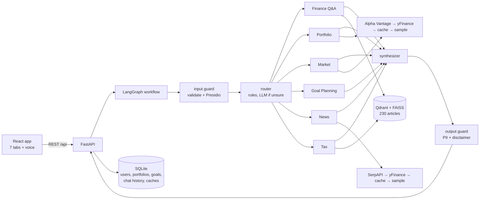

# ClarityFI – AI Finance Assistant

**Live:** https://clarityfi.rajur-dev.com

A multi-agent financial **education** assistant. Ask money questions in plain English (typed or spoken), analyze a sample portfolio, check markets, plan a savings goal, read the news, and learn tax concepts. It explains; it does not give personal financial, investment, legal or tax advice, and every answer says so.

**Stack:** React (Vite) · FastAPI · LangGraph + LangChain · OpenAI (GPT, embeddings, Whisper, TTS) · Qdrant + FAISS hybrid retrieval · SQLite · Presidio PII protection · Langfuse / LangSmith tracing.

| | |
|---|---|
| **6 agents** | Finance Q&A · Portfolio · Market · Goal Planning · News · Tax Education |
| **Knowledge base** | 230 curated articles, ~50 categories, hybrid dense + keyword search with source links |
| **Live data** | Alpha Vantage → yFinance → last saved copy → clearly-labelled sample data; SerpAPI Google News with the same fallbacks |
| **Honesty rule** | Anything served from a cache, an old copy, or sample data is *always* labelled in the UI, the API and spoken answers |
| **Privacy & sign-in** | Accounts with hashed passwords and per-user data isolation; email-based password reset (single-use, time-limited link); personal data is stripped before text reaches any model, database, cache or trace (fails closed) |
| **Voice** | Browser voice (free) or OpenAI Whisper + TTS ("HD voice") |
| **MCP server** | Four read-only tools (`get_quote`, `analyze_portfolio`, `search_knowledge_base`, `project_goal`) for Claude Desktop and other MCP clients: [docs/mcp.md](docs/mcp.md) |
| **Quality** | 1,308 backend tests (99% coverage) · 46 frontend tests · 29 end-to-end scenarios |

Design details, diagrams and decisions: [docs/design.md](docs/design.md). Demo walkthrough: [docs/demo_script.md](docs/demo_script.md).

## Architecture at a glance



The important rule: **code computes every number; the model only explains.** Prices, portfolio metrics and goal projections come from tested Python functions. A grounding check throws away any explanation containing a figure that was not in the computed facts and falls back to a plain template.

## Quick start (macOS)

Prerequisites: Python 3.12+, Node 20+, an OpenAI API key.

```bash
cp .env.example .env        # then fill in the keys (this file is git-ignored; never commit it)
./start.command             # first run: venv, npm install, spaCy model, knowledge-base ingest (a few cents of embeddings)
```

Open http://127.0.0.1:5173 (interactive API docs: http://127.0.0.1:8000/docs). Stop with Control+C.

Prefer [uv](https://docs.astral.sh/uv/) over the `venv`/`pip` flow above? See [docs/installation_uv.md](docs/installation_uv.md).

**Keys** (`.env`): `OPENAI_API_KEY` (required) · `ALPHAVANTAGE_API_KEY`, `SERPAPI_API_KEY` (optional, richer data; without them the app falls back to yFinance and sample data and says so) · `LANGFUSE_*`, `LANGSMITH_*` (optional tracing; traces are PII-masked).

### Signing in
The first screen is a sign-in form.
- **Demo accounts:** `learner-101` … `learner-110` have synthetic portfolios and goals. Their shared password is shown on the sign-in screen (default `clarity-demo`; change it with `DEMO_PASSWORD` in `.env`, or switch demo login off with `DEMO_LOGIN_ENABLED=false`).
- **Your own account:** choose *Create an account*, pick any user id (3+ characters) and a password of 8+ characters. The id is saved with an empty portfolio you can fill in.
- **Privacy between users:** you can only see and change your own portfolio, goals, profile and chat history. Sessions last 7 days and end when you sign out.
- **Administrators:** put comma-separated ids in `ADMIN_USER_IDS` to let them upload knowledge and glossary files (everyone else sees the upload control hidden).
- Passwords are stored as salted scrypt hashes; the session cookie is HttpOnly and only a hash of its token is stored; repeated wrong passwords are throttled (5 tries per 15 minutes per client and id).

## Using the app

| Tab | What it does |
|---|---|
| **Finance Q&A** | Chat with cited answers, follow-up questions, voice in/out, "HD voice" toggle, JSON knowledge upload. Multi-topic questions ("What is AAPL trading at and what is an ETF?") are split across agents. |
| **Portfolio Analysis** | Value, allocation donut with hover-highlighted class bars, per-holding table with price source, diversification score, risk label, fees, gain/loss, notes; risk-comfort setting; "what-if" box (`VTI 10` per line, not saved); plain-language explanation; **how today's mix would have performed against a benchmark** (S&P 500, Nasdaq-100, total market or bonds) with a rebased chart, percentage-point gaps, coverage and a computed reading. |
| **Market Analysis** | Overview of five market segments (US large/tech/small, international, bonds) with 1- and 3-month bars and a plain-language comparison; watchlist quotes (provider + freshness); interactive six-month chart with 20/50-day averages; comparison against a benchmark (S&P 500, Nasdaq-100, total market, bonds); a "what these numbers may mean" reading built only from computed values. Hover any chart, or focus it and use the arrow keys, for exact values. |
| **Goal Planning** | Three return scenarios, yearly path chart, assumptions, save/delete goals, plain-language explanation. |
| **News Synthesizer** | Recent headlines with source links and an optional summary; headlines are treated as untrusted web text. |
| **Glossary** | 200+ searchable terms (read-only after first load). |
| **Tax Education** | Ask how tax concepts and account types work; never computes your tax or says what to file. |

### Try the API

```bash
# sign in first; the session cookie is kept in a jar. Every state-changing call needs the X-Clarity-Client header.
H='X-Clarity-Client: web'; J='content-type: application/json'
curl -s -c jar.txt localhost:8000/api/auth/login -H "$H" -H "$J" -d '{"user_id":"learner-105","password":"clarity-demo"}'

# a cited answer (add "conversation_id" to keep context)
curl -s -b jar.txt localhost:8000/api/chat -H "$H" -H "$J" \
  -d '{"user_id":"learner-105","conversation_id":"demo","question":"What is an ETF?"}'

# portfolio analysis and comparison, market quotes, goal projection
curl -s -b jar.txt localhost:8000/api/portfolio/learner-105/analysis
curl -s -b jar.txt localhost:8000/api/portfolio/learner-105/comparison?benchmark=SPY
curl -s -b jar.txt 'localhost:8000/api/market/quotes?symbols=VTI,AAPL'
curl -s -b jar.txt localhost:8000/api/goals/project -H "$H" -H "$J" \
  -d '{"name":"House","target_amount":50000,"current_savings":5000,"monthly_contribution":300,"years":8}'
```

Errors are always `{"detail": "...", "code": "..."}`; rate limits return `429` with `Retry-After`.

<details><summary><b>All endpoints</b></summary>

| Method | Path | Purpose |
|---|---|---|
| POST | `/api/chat` | One entry point for every question (router → agents → answer) |
| GET/DELETE | `/api/conversations/{user}/{conversation}` | Restore / delete a saved chat |
| GET/PUT | `/api/portfolio/{user}` | Read / replace holdings and cash |
| GET/POST | `/api/portfolio/{user}/analysis` | Analysis of the saved portfolio / a what-if (`?explain=true` adds narration) |
| GET | `/api/portfolio/{user}/comparison` | Today's holdings replayed over past prices vs a benchmark (hypothetical) |
| GET | `/api/market/quotes`, `/api/market/trend/{symbol}`, `/api/market/context/{symbol}`, `/api/market/overview`, `/api/market/status` | Quotes, history + trend, benchmark comparison + interpretation, segment overview, provider health/quota |
| POST | `/api/goals/project` | Projection under three scenarios centered on your own `assumed_return_pct` (0% by default; `explain` optional) |
| GET/POST/DELETE | `/api/goals/{user}[/{id}]` | Saved goals (max 20) |
| GET | `/api/news` | Headlines (`summarize=true` adds narration) |
| POST | `/api/auth/register`, `/api/auth/login`, `/api/auth/logout` · GET `/api/auth/me`, `/api/auth/config` | Accounts and sessions (public routes; everything else needs sign-in) |
| GET | `/api/users`, `/api/users/{id}` · PUT `/api/users/{id}/profile` | Demo user list, profile |
| GET/POST | `/api/glossary`, `/api/glossary/initialize` | Glossary |
| POST | `/api/ingest/file` | Add JSON/JSONL knowledge to the index |
| POST/GET | `/api/audio/transcribe`, `/api/audio/speak`, `/api/audio/status` | Whisper / TTS |
| GET | `/api/health`, `/api/stats` | Readiness, index and cache statistics |
</details>

## Configuration

Secrets live only in `.env`. Everything else is in [`config.yaml`](config.yaml): model settings, retrieval (`score_threshold`, top-k), cache TTLs and the semantic-match threshold (0.90), market provider order and quotas, PII entities/thresholds, per-agent timeout, rate limits, audio limits.

## Testing

```bash
.venv/bin/python -m pytest -q                       # backend: 1,308 tests, offline, no keys needed
.venv/bin/python -m pytest -q --cov=src             # with coverage (99%)
.venv/bin/python -m pytest tests/e2e -q             # 29 end-to-end scenarios only
npm --prefix frontend test                          # frontend: 46 tests
PYTHONPATH=. .venv/bin/python -m scripts.benchmark # LIVE latency / cache / retrieval benchmark (uses your keys; a few cents)
```

Tests are isolated to a temporary database and index and never call external services or use real keys.

## Project layout

```
src/agents/      six agents + shared BaseAgent, narration (grounding check), entity extraction
src/workflow/    LangGraph graph, router, conversation memory (SQLite)
src/core/        config, models, PII, disclaimers, freshness labels, portfolio/goal/market calculators, tracing, audio
src/rag/         loaders, Qdrant + FAISS stores, hybrid knowledge base, exact + semantic answer cache, ingest CLI
src/data/        SQLite schema/repositories, synthetic users, market and news clients, caches, 230-article KB
src/web_app/     FastAPI app, routers, error mapping, rate limiting
src/mcp_server/  MCP server (stdio) exposing four read-only tools
frontend/        React app (tabs in src/tabs/, shared api.js / common.jsx)
tests/           unit/ integration/ e2e/        scripts/benchmark.py        docs/
```

## Troubleshooting

| Symptom | Cause / fix |
|---|---|
| New endpoints return **Not Found** | An older server is still on port 8000. Stop it (`lsof -nP -iTCP:8000 -sTCP:LISTEN`, then `kill <pid>`) and start again. |
| "Address already in use" or Qdrant lock error on ingest | The embedded Qdrant folder allows one process. Stop the API before `python -m src.rag.ingest --reset`. |
| Prices say *saved copy* / *last known* / *SAMPLE DATA* | Working as designed: live providers were unavailable or rate-limited (Alpha Vantage free tier is 25 requests/day). Yahoo Finance usually covers the gap; sample data appears only when every provider is down. |
| Health shows `needs_setup` | Missing/invalid `OPENAI_API_KEY`, or the knowledge base is empty: run the ingest command above. |
| 503 "privacy filter unavailable" | The spaCy model is missing: `python -m spacy download en_core_web_lg`. The app refuses to send text unfiltered. |
| Voice input does nothing | Browser speech recognition needs Chrome/Safari; otherwise enable **HD voice** (Whisper). Allow microphone access. |
| 429 Too many requests | Per-user/per-client limits (`config.yaml → api`, `auth`). Wait for `Retry-After` seconds. |
| Signed out unexpectedly / 401 | The session ended (7 days, sign-out, or the server database changed). Sign in again. |
| 403 "blocked because it did not come from the ClarityFI app" | State-changing calls need the `X-Clarity-Client: web` header (the web app adds it; add it to curl/scripts). |
| Forgot a password | Use "Forgot password?" on the sign-in screen. In local dev (`EMAIL_PROVIDER=console`, the default) the reset link is printed to the server log instead of emailed — copy it from there. Set `EMAIL_PROVIDER=ses` plus a verified SES sender to actually send email. Demo accounts always use the demo password. |
| Where are the server logs? | `start.command` runs the API in the background and writes its output to `/tmp/clarity-api.log`. Every line (uvicorn's own startup/access lines and the app's own `Entering`/`Leaving agent`, routing and LLM-call lines) is timestamped `YYYY-MM-DD HH:MM:SS`; the app's own lines are JSON (`uvicorn_log_config.json` controls only uvicorn's format, `config.yaml → logging` controls the app's). |

## Known limits

- Market data on the free Alpha Vantage tier is 25 requests/day; the app paces requests, tracks quota in the database, and falls back visibly.
- Rate limits and sign-in throttling are in-memory (per process). There is no e-mail verification or multi-factor sign-in yet (password reset is supported — see the FAQ above), and the demo password is public by design. User ids created before sign-in existed can be claimed by the first person to register them. For a public deployment use HTTPS (the cookie becomes `Secure` automatically) and a shared store for limits.
- All 230 knowledge-base articles now carry a real, verified source and link (as of 2026-09-25; the original 90 placeholder-sourced articles were all re-sourced to real citations — SEC/Investor.gov, FINRA, IRS, CFPB, FDIC, TreasuryDirect and a few reputable finance-education sites). Search still prefers linked articles when they are nearly as relevant (`rag.sourced_bonus` in `config.yaml`), which now has no remaining placeholder-sourced articles to matter for.
- Street addresses and dates of birth are not detected by the privacy filter.
- Deployed on AWS EC2 (Docker Compose + Caddy): see [docs/deployment_aws.md](docs/deployment_aws.md).

Educational use only. Not personalized financial, investment, legal or tax advice.
