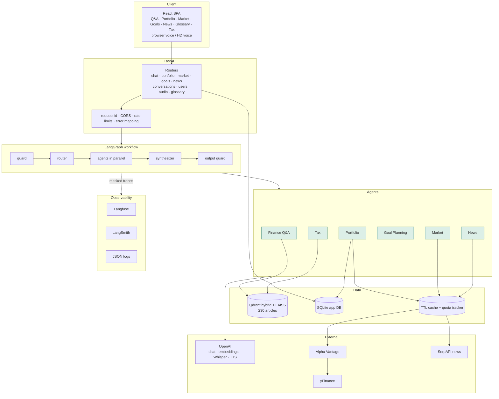
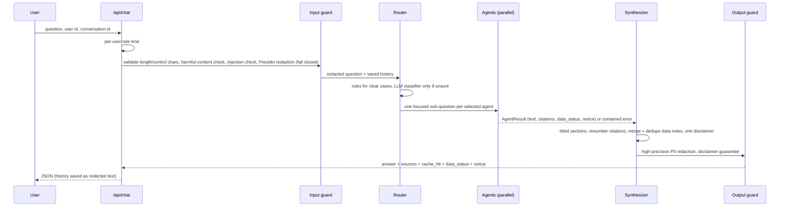
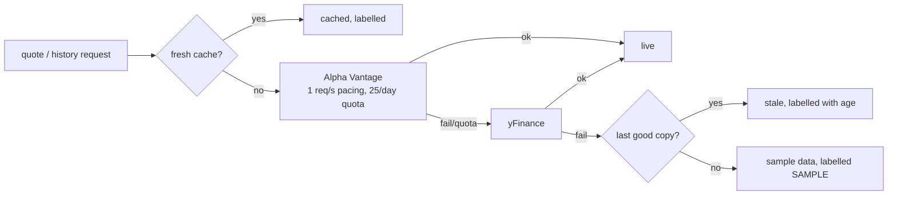

# ClarityFI – Design

## 1. Goals and principles

1. **Education, not advice.** Every answer carries an education-only statement; "should I buy X?" is redirected to how to think about the decision.
2. **Code computes, the model explains.** All numbers (prices, allocations, projections) come from deterministic, unit-tested functions. A *grounding check* rejects any narration containing a $/%/large figure absent from the computed facts and substitutes a plain template. The same template is used when the model is unavailable, so data features degrade instead of failing.
3. **Say where data came from.** Every value carries a status: `live`, `cached`, `stale` (last known) or `sample`. Non-live values always show a badge and a plain-language notice in the API, UI and spoken output. Sample prices are never used to value a portfolio.
4. **Privacy fails closed.** Personal data is redacted before text reaches any model, database, cache, log or trace. If the redactor breaks, the request is refused rather than sent unfiltered.
5. **Untrusted input.** User text and web headlines are data, never instructions (prompt rules, control-character stripping, injection heuristics).
6. **Contain failures.** A slow or failing agent is cut off and reported; the rest of the answer still returns.

## 2. System architecture

### Request workflow, at a glance

A single request's path end to end — combining the architecture and sequence diagrams below into one colored view of the guard → router → agents → synthesizer → output-guard pipeline.

```mermaid
flowchart LR
    U(["👤 User"]):::client -->|"question, user id,<br/>conversation id"| RL["Rate limit<br/>per-user window"]:::gate
    RL --> IG{{"Input Guard<br/>length/control-char<br/>harmful-content<br/>injection heuristics<br/>Presidio redaction<br/>(fail-closed)"}}:::guard
    IG -->|"self-harm /<br/>violence detected"| SAFE["Deterministic safety<br/>response (crisis<br/>resources or refusal)<br/>never reaches an LLM"]:::danger
    IG -->|"redacted question<br/>+ history"| RO{{"Router<br/>rules for clear cases<br/>LLM classifier<br/>only if unsure"}}:::route
    RO -->|"one focused<br/>sub-question<br/>per agent"| FAN

    subgraph FAN["Agents — parallel fan-out, per-agent timeout"]
        direction TB
        QA["Finance Q&A"]:::agent
        PF["Portfolio"]:::agent
        MK["Market"]:::agent
        GP["Goal Planning"]:::agent
        NW["News"]:::agent
        TX["Tax"]:::agent
    end

    FAN -->|"AgentResult: text,<br/>citations, data_status,<br/>notice — or a<br/>contained error"| SY[["Synthesizer<br/>titled sections<br/>renumber citations<br/>merge + dedupe notes<br/>one disclaimer"]]:::synth
    SY --> OG{{"Output Guard<br/>high-precision<br/>PII redaction<br/>disclaimer guarantee"}}:::guard
    OG -->|"answer + sources +<br/>cache_hit + data_status<br/>+ notice"| RESP(["Response to user<br/>(history saved as<br/>redacted text)"]):::client
    SAFE -.->|"logged, never<br/>persisted to history"| RESP

    classDef client fill:#183029,stroke:#183029,color:#ffffff,stroke-width:2px
    classDef gate fill:#eee9fa,stroke:#6651a8,color:#183029,stroke-width:1.5px
    classDef guard fill:#d76b52,stroke:#a4432c,color:#ffffff,stroke-width:2px
    classDef route fill:#6651a8,stroke:#3f3169,color:#ffffff,stroke-width:2px
    classDef agent fill:#dcefe7,stroke:#176f59,color:#0f5947,stroke-width:1.5px
    classDef synth fill:#176f59,stroke:#0f5947,color:#ffffff,stroke-width:2px
    classDef danger fill:#ffe3da,stroke:#d76b52,color:#7a2c17,stroke-width:2px
```

### Architecture and sequence detail

### Chat request lifecycle

## 3. Components

### 3.1 Workflow (`src/workflow`)
A LangGraph `StateGraph`: **guard → route → agent nodes (fan-out with `Send`, per-agent timeout) → synthesize → output_guard**. State carries the redacted question, history, intents, agent results, notices, and the final answer.

- **Router** – Rules decide clear cases (ticker prices, "my portfolio", tax terms, goal phrasing, news words); an LLM structured-output classifier handles unsure ones; if it fails, the rules answer. It also detects *advice requests* and multi-part questions, and gives each agent its own clause (`focus_question`) so an agent never answers a part meant for another. Measured on questions written after tuning: 88% (35/40) end-to-end; the tuning sets are kept as regression tests.
- **Synthesizer** – Orders sections, renumbers `[n]` citations when several agents cite, merges data notes into one deduplicated note, keeps exactly one disclaimer, explains partial failures, and adds the education redirect for advice requests.
- **Memory** – `SqliteConversationMemory` persists redacted messages per (user, conversation) so history survives restarts. A LangGraph checkpointer was deliberately not used: explicit tables are easier to audit and to purge.

### 3.2 Agents (`src/agents`)
All extend `BaseAgent`: contained errors → `AgentResult.error/error_code`, a tracing span with pseudonymous user/session ids, latency, structured logs, and `as_node()` for the graph.

| Agent | Data | Notes |
|---|---|---|
| **Finance Q&A** | Knowledge base | cache → hybrid retrieval → relevance gate (no LLM call if nothing relevant) → grounded answer → disclaimer → cache write. Judges relevance on the *current* question; borrows earlier turns only for short/pronoun-led follow-ups. |
| **Tax** | Tax slice of the KB (incl. retirement accounts) | Specialises Q&A: stricter prompt (never compute a person's tax, never quote limits/rates absent from context), always-on caveat, personal-tax redirect. |
| **Portfolio** | SQLite holdings + market prices | Value, allocation by holding/class, gain/loss, weighted expense ratio and annual fee, diversification score with broad-fund look-through, risk score/label, mismatch vs stated risk comfort. Prices marked non-live are disclosed; sample prices fall back to cost basis. |
| **Market** | Market chain | Quotes, trends (SMA, returns, volatility, drawdown), index-proxy explanations. The web app adds market context (below). |
| **Goal Planning** | Saved goals + user text | The LLM extracts figures, but a value is trusted only if it literally appears in the user's message; never silently substitutes an unrelated saved goal. Three scenarios, required monthly total, inflation-adjusted values. |
| **News** | News chain | Headlines are untrusted web text; sample headlines are listed, never narrated as news; citations link to publishers. |

### 3.3 Retrieval (`src/rag`)
- **Hybrid search**: Qdrant with a dense vector (OpenAI `text-embedding-3-small`) and a BM25-style sparse vector (server-side IDF), fused with reciprocal-rank fusion; category filter; dense cosine kept as the relevance score. **FAISS** (dense) is the automatic fallback if Qdrant errors or is empty. Each chunk is embedded once for both indexes.
- **Source preference**: all 230 articles now carry a real source (the original 90 placeholder-sourced articles were all re-sourced to real citations on 2026-09-25). Retrieval still re-orders 3× candidates by relevance plus a small boost (`rag.sourced_bonus`, 0.08) for articles with a real source link, from when placeholder-sourced articles existed; only the order changes, and each result's own score (used by the relevance gate) is untouched. Live: top-3 results now average 2 of 3 linked, and retrieval quality stayed 10/10.
- **Answer cache**: exact match on the normalised question, then semantic match (cosine ≥ 0.90, calibrated on real embeddings: paraphrases scored 0.91+, different questions ≤ 0.81). Guards prevent wrong hits: same numbers (401k vs 403b), same negation words, comparison questions exact-only (a mirrored "A better than B" scored 0.94), same category scope, same knowledge-base version. Follow-ups, refusals and redacted questions are never cached. Cache hits are disclosed ("Answered from a saved response…").

### 3.3a Portfolio versus benchmark (`core/portfolio_history.py`, `/api/portfolio/{user}/comparison`)
Replays today's holdings (and cash) over past prices to answer 'how would this mix have done?': daily value = Σ shares × close + cash on the dates every included holding has a price, compared with a benchmark rebased to 100. It is explicitly hypothetical (ignores when positions were actually bought, taxes and fees). Holdings without usable history are excluded and listed with the resulting coverage of invested value; SAMPLE history is never used; several cached histories collapse into one notice naming the oldest age; a benchmark failure degrades to the portfolio's own numbers. The reading is built only from computed values (return and gap in percentage points, drawdown, volatility) and ends with a no-prediction, no-recommendation caveat.

### 3.3b Market context (`market_calc.py`, `/api/market/context`, `/api/market/overview`)
Beyond a symbol's own numbers, the app puts them in context, all computed in code: (1) a **benchmark comparison** (default SPY as an S&P 500 proxy) with percentage-point gaps in 1- and 3-month return and volatility, and both series rebased to 100 on shared dates; (2) a **segment overview** (SPY, QQQ, IWM, VXUS, BND as US large / tech / small, international, bonds) with cross-segment takeaways such as which led and whether stocks and bonds moved together; (3) **interpretation**: plain sentences built from the computed values (price versus 20/50-day averages, distance below the period high, volatility band, relative performance) with a closing 'past only, not a recommendation' line. No sentence can state a figure the data does not contain, and no forecast or buy/sell language is generated. A benchmark failure degrades to the symbol's own reading with a notice; each segment carries its own freshness status.

### 3.4 Data layer (`src/data`)
SQLite schema v6: `users`, `auth_sessions`, `sessions` (with `conversation_key`), `messages` (redacted content only), `holdings`, `portfolio_cash`, `goals`, `kv_cache` (TTL/stale), `api_usage` (quota), `qa_cache`. Migrations run in `Database._migrate`. `seed.py` deterministically creates ten synthetic users (learner-101…110) covering aggressive/near-retiree/all-cash/single-stock/index-fund/bond-heavy/crypto/real-estate/empty/beginner cases. Saving a goal (`POST /api/goals/{user_id}`) upserts by name (case/whitespace-insensitive): a name that already exists for that user updates the existing row in place (status 200) instead of creating a duplicate (status 201 for a genuinely new name).

News follows the same shape (SerpAPI → yFinance news → last saved → sample) with PII-redacted queries, keyword retry, negative caching and a monthly quota.

### 3.5 Privacy and safety
- **Presidio + spaCy `en_core_web_lg`** with finance-specific tuning: ticker and public-figure allow-lists (Buffett, Bogle…), finance terms named after people (Roth, Sharpe, Ponzi), loose SSN and API-key recognisers, per-entity thresholds.
- **Input** redacts all configured entities; **output** uses high-precision entities only (emails, phones, SSNs, cards, IBANs, IPs, keys) because name detection mislabels numbers.
- Only redacted text is stored, cached, traced or sent to a model or search provider. Tracing masks are fail-closed too. Settings reprs hide secret fields.
- Input validation: length, control characters, prompt-injection heuristics; user ids restricted to a safe charset.
- Harmful-content guard (`core/safety.py`): a heuristic check, upstream of the router, for self-harm and violent content. Self-harm gets a deterministic crisis-resource response (988, Crisis Text Line) generated by code, never sent to an LLM or agent; violent/weapons requests get a flat refusal. Neither is persisted to conversation history.
- **Accounts and sessions** (`core/auth.py`, `web_app/auth_service.py`, `web_app/security.py`): passwords are scrypt-hashed with per-password salts and verified in constant time (unknown ids still cost one verification, and errors do not reveal which ids exist); sessions are random tokens in an HttpOnly, SameSite=Lax cookie (Secure over HTTPS) and only the SHA-256 of a token is stored, so a database leak yields no usable sessions; sign-in failures are throttled per client+id and per client. `require_login` is an application-wide dependency, so **new routes are protected by default** (a test walks the OpenAPI spec and fails if any non-public route answers an anonymous request); it also enforces that a `{user_id}` in the path belongs to the caller, requires the `X-Clarity-Client` header on every state-changing request (CSRF defence: a cross-site form cannot set it), and chat/goal handlers ignore any user id in the body that is not the caller's. Knowledge and glossary uploads are administrator-only (`ADMIN_USER_IDS`). Demo users sign in with a documented demo password; ids that predate sign-in can be claimed once by the first to register them. The MCP server is a local stdio process for the machine's owner and does not use web sessions.
- Rate limits: per-user chat, per-client for LLM-backed and read endpoints (sliding window, `Retry-After`).

### 3.6 Observability
JSON logs with request/session ids and secret masking; Langfuse traces (spans per agent, generations with token counts, pseudonymised user/session); LangSmith runs via an explicit masking tracer (environment auto-tracing is disabled in code so nothing unmasked can be uploaded). Errors carry stable `code`s mapped to HTTP statuses.

### 3.7 MCP server (`src/mcp_server`)
A stdio MCP server (SDK v2 `MCPServer`) with four read-only tools that reuse the API's services: the market chain, `PortfolioAgent.analyze`, the knowledge base, and the goal projector. The same rules apply: numbers come from code, non-live data is labelled with a `notice`, search queries are validated and PII-redacted (fail closed), and every result carries the disclaimer. Anticipated failures use `ToolError` so the calling model can read and correct them; crashes expose nothing. If the web API holds the embedded Qdrant index, search transparently uses the FAISS copy. See [mcp.md](mcp.md).

### 3.8 Frontend
Vite + React. `App.jsx` holds the user gate, workspace shell and Finance Q&A; the other tabs live in `src/tabs/`. `api.js` centralises fetch, error and 429 handling; `common.jsx` provides status badges, notices, and an interactive SVG `LineChart` (hover or arrow-key crosshair, a dot and tooltip per series, dated axis, low/high, legend, dashed reference lines, gaps for missing values, moving-average helper). Charts: price with 20/50-day averages, symbol versus benchmark, goal scenarios against the target line, allocation donut with per-class bars that highlight on hover. Voice: browser Web Speech by default; "HD voice" records with `MediaRecorder`, transcribes through `/api/audio/transcribe`, and speaks with `/api/audio/speak`, falling back (and saying so) to the browser voice on failure.

## 4. Key decisions and trade-offs

| Decision | Why | Cost |
|---|---|---|
| Qdrant hybrid with FAISS fallback | Keyword + meaning search finds both exact terms and paraphrases; fallback keeps Q&A alive | Embedded Qdrant allows one process |
| Rules-first router, LLM only when unsure | Cheap, fast, predictable; measured accuracy drives the design | Rules need maintenance; tests guard them |
| Deterministic numbers + grounding check | The model cannot invent a figure that reaches the user | Explanations are less free-form |
| Own SQLite memory, no LangGraph checkpointer | Auditable, easy to delete, redacted-only | Less generic than a checkpointer |
| Conservative semantic cache (0.90 + guards) | A wrong cached answer is worse than a miss | Lower hit rate on short paraphrases |
| Disclose every non-live value | Trust and the explicit product requirement | More notices in the UI |
| Cookie sessions + scrypt passwords, no external identity provider | Works offline, no extra dependencies, secure defaults | No e-mail verification or MFA yet; in-memory throttling (password reset added 2026-09-26 — single-use, time-limited email link, console-logged in dev / SES in production) |

## 5. Testing strategy
- **Unit** (≈1,100): calculators (cross-checked against independent simulation), PII, router labelled sets, caches, providers, agents with fake models, repositories, API routes, error mapping, rate limiter.
- **Integration**: workflow with real graph and fake agents/models; agents inside a real LangGraph.
- **End-to-end** (29): the real HTTP app with deterministic stand-ins for model, prices, news and KB; every synthetic user, cache disclosure, stale/sample disclosure, PII never reaching model/DB/reply, injection, outages, rate limits.
- **Frontend** (46): each tab with mocked fetch, voice flows, StrictMode regression, password-reset flows.
- **Live**: `scripts/benchmark.py` and manual real-browser walkthroughs; live verification against OpenAI, Alpha Vantage, SerpAPI, Langfuse and LangSmith was done at each step.
- Coverage: 99% of `src`.

Measured live: retrieval 10/10 (top-3 contains an expected category); fresh answer ≈ 2–5 s (model call dominates); exact cache ≈ 80 ms; semantic cache ≈ 430 ms; portfolio question ≈ 50 ms.

## 6. Known limits and future work
- Deployed on AWS EC2 (Docker Compose + native Caddy, HTTPS via Let's Encrypt, survives reboot) — see [deployment_aws.md](deployment_aws.md). Vercel was considered but dropped in favor of one box serving both the API and the static frontend.
- Add a shared rate-limit store (a single EC2 process's in-memory limiter is a reasonable fit for the current single-instance deployment, but wouldn't survive multiple instances behind a load balancer); detect street addresses and dates of birth in the privacy filter.
